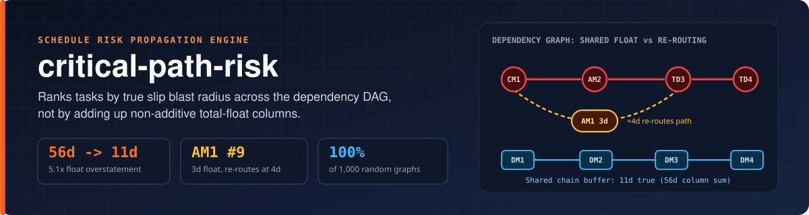
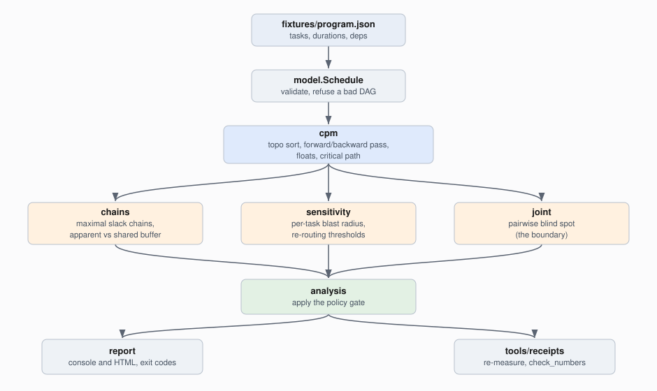
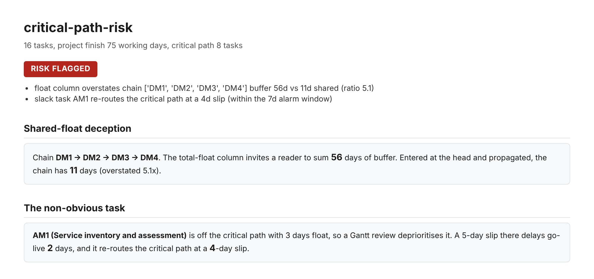
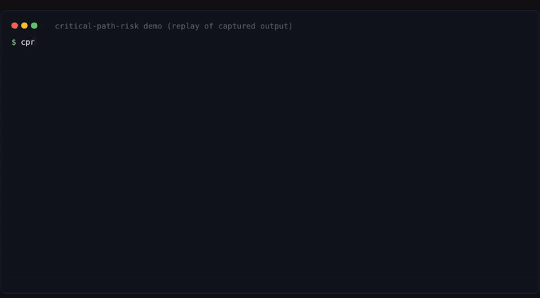

<div align="center">
  
</div>

# critical-path-risk

**Ranks the tasks in a project schedule by the true blast radius of a slip, computed by propagating the delay through the whole dependency graph rather than read off a total-float column. On a 16-task banking modernization program, the float column claims a chain has 56 task-days of buffer; propagation says 11.**

[](https://github.com/Venkata-Pramid-Reddy-Mitta/critical-path-risk/actions/workflows/ci.yml)


[](https://Venkata-Pramid-Reddy-Mitta.github.io/critical-path-risk/)

## What a Gantt chart cannot tell you

A dependency chart and its total-float column are the two artifacts a program manager reads to judge schedule risk. Four questions they structurally cannot answer, no matter how carefully they are read:

1. How much schedule buffer does a chain of slack tasks actually have? The float column invites you to add the numbers up, and they are not additive.
2. Which task that the chart calls "non-critical" is closest to becoming critical, and how close?
3. For a one-week slip, which single task does the most damage to the finish date, once the delay is propagated rather than guessed?
4. Which risk is invisible to this tool itself?

Total float is **shared** down a chain, not summed across it, and the critical path silently **re-routes** the moment any slip exceeds a task's float. The only way to get a task's real blast radius is to inflate its duration, re-run the longest-path computation, and measure how far the finish moved. That propagation is what this repository does.

## The uncomfortable numbers

On the committed fixture, a deliberately built 16-task program finishing in **75 working days** with a **critical path of 8** tasks:

- The total-float column **sums to 56** task-days of buffer across the data-migration chain (DM1, DM2, DM3, DM4). Entered at the head and propagated, the chain has a **shared buffer of 11** days: a **5.1x** overstatement. Slip the head by 11 days and the finish holds; slip it by 12 and it moves.
- Task AM1 is off the critical path with **3 days of float**, so a Gantt review deprioritizes it. It **ranks 9** in blast radius, behind only the eight critical tasks, and a **4-day slip** there re-routes the critical path onto it. A one-week (**5-day slip**) there delays **go-live 2 days**.
- The boundary, which this tool cannot see: DM2 and DM3 each absorb a **slip of 11 days** with zero delay measured alone. Slipped together they delay **go-live 11 days**. The single-slip ranking reports 0 and 0 for exactly the pair that, together, does the damage.

These are not cherry-picked: across **1000 random programs** nobody tuned, the float column overstated the worst chain's buffer by at least 2x **in 100% of** them, a **median 4.0x**, and a slack task sat within the seven-day re-routing alarm in **29.1% of** them (experiment 5).

Every number in this document is re-measured from a fresh run by `make verify`: **154 tests**, **100% line** and **100% branch** coverage, and a checker that fails the build if any figure here drifts from the code.

## Quickstart

Prerequisites: Python 3.11, 3.12 or 3.13. No other runtime dependency; the analysis is pure standard library.

```bash
python -m pip install -e ".[dev]"

# The headline: analyze the committed program and print the report.
python -m cpr.cli analyze fixtures/program.json

# Re-measure every number in this README and check the prose against it.
make verify
```

`make verify` runs offline from a fresh clone. It is the one command this README promises a reviewer.

## The shared-float deception

A reader who sees DM1, DM2, DM3 and DM4 each carrying double-digit float is tempted to believe the chain has plenty of slack. The float column, summed, agrees. Propagation does not.

| Measure | Days | How it is obtained |
| --- | --- | --- |
| Apparent buffer (sum of the column) | 56 | sum of the four total floats |
| Shared buffer (entered at the head) | 11 | slip DM1 until the finish moves, verified by propagation |
| Overstatement | 5.1x | apparent divided by shared |

The shared buffer is the head task's total float, and the tool does not take that on trust: `sensitivity.measure_shared_buffer` slips the head by exactly 11 days (finish must hold) and by 12 (finish must move), and raises if the engine disagrees with the identity. DM4 genuinely has independent slack of its own, which is the subtlety: that slack belongs to DM4 alone and shrinks the moment a delay arrives from upstream. The column cannot tell shared float from independent float. This tool can.

## The non-obvious task

| Task | On critical path | Float (days) | Delay from a 5-day slip | Blast-radius rank |
| --- | --- | --- | --- | --- |
| CM1 ... TD4 (8 tasks) | yes | 0 | 5 | 1 to 8 |
| AM1 | no | 3 | 2 | 9 |
| DM1, CM3, DM2 | no | 11 | 0 | 10+ |

AM1 is the task a status review waves through: it has float, so it is "not critical". But its float (3 days) is smaller than a one-week slip, so the slip spills over, and it sits a **4-day slip** from joining the critical path outright. The ranking surfaces it; the Gantt hides it.

## The cost against the buy

| What propagation costs | What it buys |
| --- | --- |
| Re-running the forward pass once per task per slip (O(V) longest-path calls) | A blast-radius number per task instead of a float the reader has to interpret |
| A committed fixture that is built, not captured | Every figure reproducible with one offline command |
| Single-slip ranking misses simultaneous slips | A measured boundary (11 days) that names exactly what to check by hand |

## The bugs the measurement found

- **Determinism under hash randomization.** An early draft seeded Kahn's ready queue from a set comprehension. On a Python with hash randomization the order of equally-ready tasks changed between runs, so the topological order was not stable. The headline numbers survived (the critical chain's internal order is forced by its edges), but the blast-radius table orders equally-ranked slack tasks by their topological position, so DM2 and CM3 (both 11 days float, both zero delay) came out in a different order from one run to the next. A committed artifact that is not byte-identical between runs is enough to erode trust even when every number in it is correct. The telling part: a test comparing only the headline summary would have missed it, because the summary was stable while the ranking underneath moved. The fix seeds the queue in insertion order and breaks every tie by it; `tests/test_determinism.py` now compares the full ranking order under six hash seeds. See ADR-003.
- **The float that was not shared.** A first cut of the chain metric reported the apparent and shared buffers as equal for every chain, which is impossible for a real merge. The overstatement ratio came out 1.0 everywhere, which is how the bug announced itself. The cause was reading free float where total float was meant; the two are different numbers and the whole deception lives in the gap between them. See ADR-004.

## Architecture



```text
program.json -> model.Schedule (validate) -> cpm (passes, floats, critical path)
             -> chains (shared vs apparent buffer)
             -> sensitivity (blast radius, re-routing threshold)
             -> joint (the pairwise boundary)
             -> analysis (policy gate) -> report (console, HTML) + receipts
```

## Evidence



The report above is generated by the tool itself; the screenshot step reads back the verdict badge's computed style and fails if it is invisible. A replay of the command line, every line of it captured from real stdout and paced by the measured wall time, is in `docs/video/demo.gif` with the command manifest in `docs/video/manifest.json`.



## The fixture, and the awkward cases in it

`fixtures/program.json` is a 16-task banking cloud modernization program across four workstreams. It is built, not captured, and the README says so plainly, because it is constructed to contain the exact cases the tool exists to catch: a slack chain whose column overstates its buffer threefold or more, a slack task within a few days of re-routing, and a pair that is safe alone but costly together. The awkward cases are the point. The seeded generator (`cpr.generator`) then produces a thousand programs nobody designed, and experiment 5 reports that the deception is structural rather than an artifact of this one graph.

## What this cannot measure

This is a section, not a footnote, because the boundary is the strongest signal here.

- **Single slips only.** The ranking stresses one task at a time. It is blind to simultaneous slips that share a chain's float, and the fixture measures exactly how blind: two 11-day slips, each rated 0 alone, delay go-live 11 days together. Joint pairwise search is the Pivot below, deliberately out of scope until single-slip analysis is adopted.
- **Finish-to-start dependencies only.** No leads, lags, or start-to-start links. A real MS Project export using those would need a richer edge model (ADR-002).
- **Deterministic durations.** This tool answers "given these durations, which slip hurts most", not "how likely is the date", which is a distribution question for a different tool. The two are deliberately separate.
- **A built fixture.** Every structural claim (shared float, re-routing, the joint boundary) would hold identically against a real schedule with the same topology, because they are graph facts. The one thing the fixture cannot stand in for is the realism of the durations themselves.

## Layout, exit codes, reproduction

```text
src/cpr/        model, cpm, chains, sensitivity, joint, analysis, report, generator, cli, config
fixtures/       the committed program
experiments/    five experiments, each answering a question above
tools/          receipts (collect_metrics, check_numbers), evidence, the em-dash guard
docs/           banner.svg, index.html (GitHub Pages), metrics.json, experiment JSON, ADRs, diagrams, screenshots, video
tests/          154 tests
```

The CLI exit codes mean something a build can act on:

| Code | Meaning |
| --- | --- |
| 0 | the analysis ran; the program is clean against the policy (or `--gate` was not set) |
| 2 | the analysis ran and a hidden risk was flagged (only with `--gate`) |
| 1 | the analysis could not run: bad input, a cycle, a broken policy file |

The distinction between 2 and 1 is deliberate: "I looked and the answer is no" is not "I could not look".

```text
make lint        ruff plus the em-dash guard
make test        pytest with branch coverage
make receipts    re-measure every number, then check the prose against it
make verify      lint, test, receipts (the reviewer command)
```

`make receipts` runs `check_numbers.py`, which guards figures by matching **anchor phrases** (the wording with the value substituted in) rather than bare digits, so a stale sentence fails the build while a coincidental "2" in a heading does not.

## Tech stack

| Technology | Role here | Why this choice |
| --- | --- | --- |
| Python standard library | the entire runtime: CPM, chains, sensitivity | the longest-path computation is the thing being demonstrated, so it is hand-written; zero runtime dependencies keeps install and offline reproduction trivial (ADR-001) |
| dataclasses | immutable schedule and result types | perturbing one duration must not mutate shared state, which is what keeps the analysis deterministic |
| tomllib (stdlib) | the policy file | a program office tunes the gate in `policy.toml` without touching code; comments explain each threshold |
| argparse (stdlib) | the CLI | meaningful exit codes with no dependency |
| pytest, coverage, ruff | tests, coverage floor, lint | the development loop; none ship at runtime |
| Playwright, ffmpeg | evidence (diagram, screenshots, replay) | regenerable evidence, committed, not hand-drawn |

## The five decisions (ADRs)

- [ADR-001](docs/adr/ADR-001-hand-rolled-cpm-not-networkx.md): hand-roll the critical path method instead of using a graph library.
- [ADR-002](docs/adr/ADR-002-finish-to-start-only.md): finish-to-start dependencies only, and why that boundary is honest.
- [ADR-003](docs/adr/ADR-003-determinism-under-hash-randomization.md): the determinism bug and the insertion-order fix.
- [ADR-004](docs/adr/ADR-004-total-float-vs-free-float.md): total float versus free float, the gap the tool lives in.
- [ADR-005](docs/adr/ADR-005-exit-codes-and-the-gate.md): exit-code semantics, and why the gate is opt-in.

## The Pivot and future work

Intentionally out of scope: **joint pairwise slip search**. Its trigger is adoption. Once a team uses the single-slip ranking in anger and starts asking "what if two chains slip together", the O(V squared) pairwise pass becomes worth its cost, and the first metric to watch is the largest joint delay among pairs each rated zero alone (the fixture's is 11 days).

Other v2 work: leads and lags in the edge model (ADR-002); resource-constrained scheduling, where float is no longer a pure graph property; and ingesting a real MS Project or Azure DevOps export behind the same analysis.

## License

MIT, see [LICENSE](LICENSE). Copyright 2026 Venkata Pramid Reddy Mitta.
